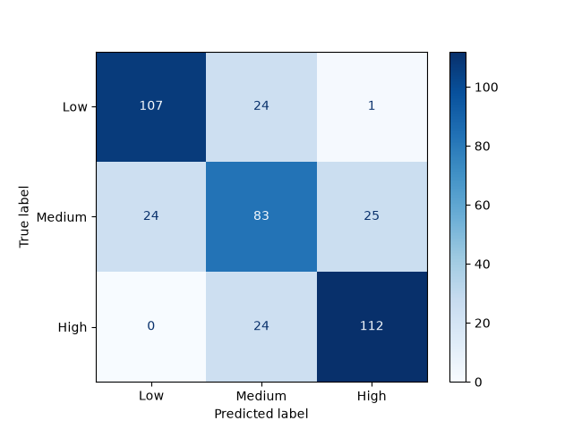
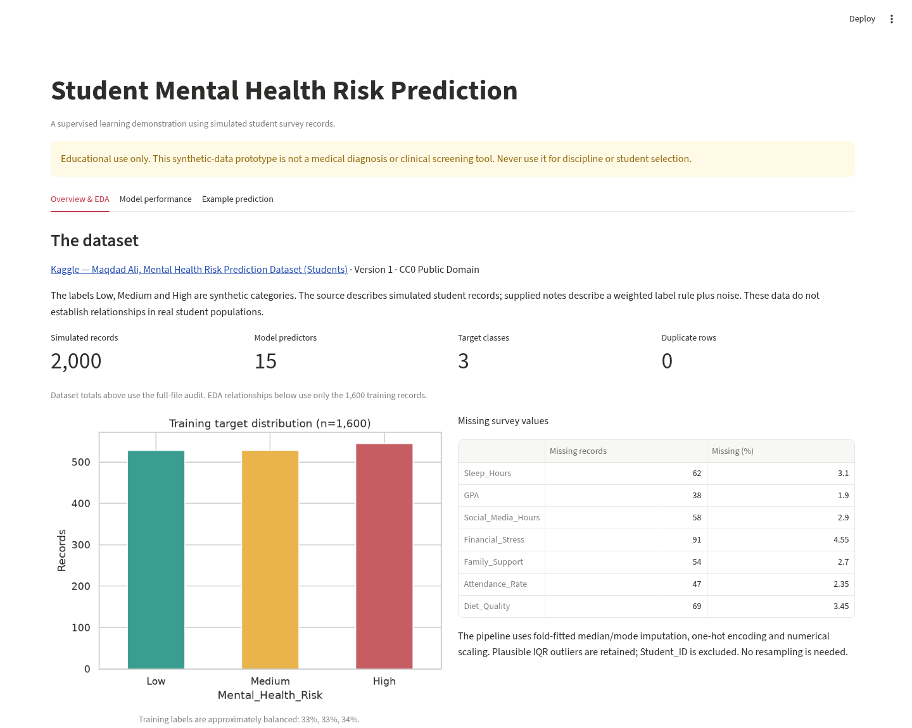
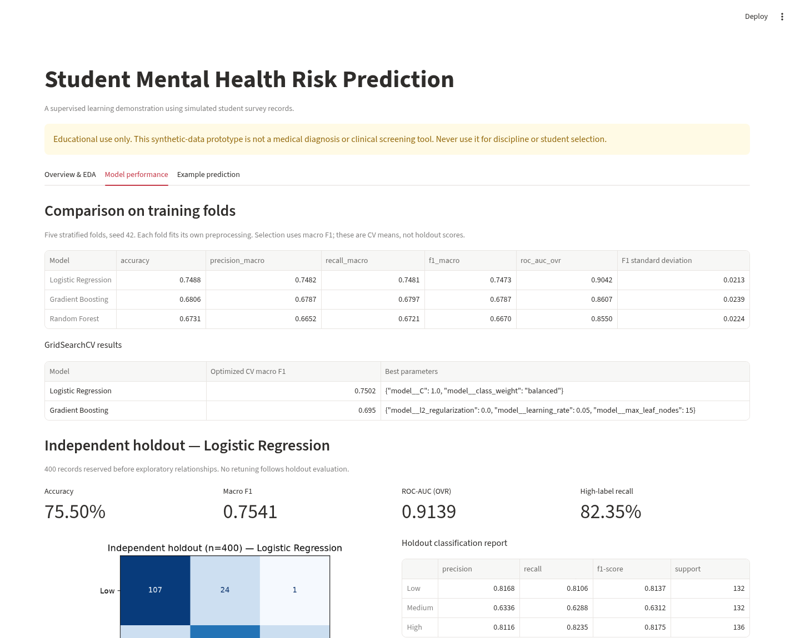
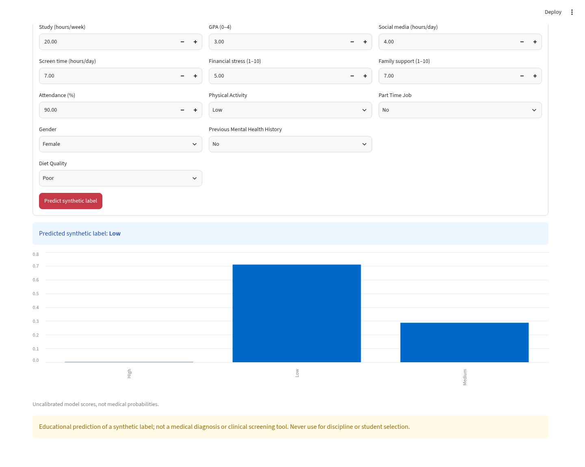

# Student Mental Health Risk Prediction

A student ML project: explore a dataset, prepare features, compare three models,
tune the best two, then serve predictions with FastAPI and Streamlit.
Airflow runs the same steps daily.

**Educational use only.** The data is synthetic. Predictions are not diagnoses
or clinical screening results and must never be used for discipline or student
selection. Class scores are uncalibrated, not medical probabilities.

[Project brief](Brief.pdf) ·
[Jira board](https://hossammirrou.atlassian.net/jira/software/projects/SMHRP/boards/2?filter=&groupBy=none)

## Dataset

[Kaggle — Mental Health Risk Prediction Dataset (Students)](https://www.kaggle.com/datasets/maqdadali/mental-health-risk-prediction-dataset-students),
version 1, CC0 Public Domain: 2,000 simulated records and 17 columns.
The target has three classes: Low=660, Medium=660, High=680.
`Student_ID` is excluded, leaving 15 predictors. Seven columns have missing values.
The source notes describe weighted labels with added noise; the exact generator
is unavailable.

The raw CSV is `data/raw/student_mental_health.csv` and is ignored by Git.
Put the original CSV there manually before running the scripts. See [data notes](data/README.md).

## Files and workflow

```text
src/data.py           Split X and y directly and save the four CSVs
src/preprocessing.py  Build numeric and categorical preprocessing
src/train.py          Compare three models and tune the best two
src/evaluate.py       Predict the test set and save scores and a confusion matrix
app/api.py            Load the saved pipeline and predict
app/streamlit_app.py  Enter survey values and display the prediction
dag/                 Schedule the four steps with Airflow
notebooks/           Walk through the analysis step by step
models/              Pipeline, scaler, simple result tables and metrics
reports/             EDA figures and earlier delivery reports
```

Open Jupyter notebooks from the `notebooks/` folder and read them in order:

1. [EDA](notebooks/01_eda.ipynb): data quality, distributions and relationships.
2. [Preprocessing](notebooks/02_preprocessing.ipynb): split, missing values, encoding and scaling.
3. [Training](notebooks/03_model_training.ipynb): three classifiers and five-fold CV.
4. [Optimization and evaluation](notebooks/04_model_optimization_evaluation.ipynb): GridSearchCV, final evaluation, error analysis and Joblib files.

Each notebook makes its split directly from the raw CSV. Notebook model files
use `models/notebooks/`, so they do not replace the app model. Earlier notebook results and plots are retained
and labeled as earlier outputs. The simplified notebooks have not been rerun
in full. Screenshots and archived reports also show the earlier implementation.
Python code comments, extra helpers, thread settings and JSON bookkeeping have
been removed. Each script has one callable function for Airflow; run the scripts from the project root.

## ML decisions and results

- Use an 80/20 stratified split with seed 42: 1,600 training and 400 test rows.
- Keep valid IQR extremes. Use numeric medians and categorical modes for missing
  answers. Encode categories and scale numbers inside each model pipeline.
- Fit preprocessing inside each CV fold to avoid data leakage.
- Classes are nearly balanced, so no resampling is needed.
- Compare Logistic Regression, Random Forest and Histogram Gradient Boosting on
  the same five stratified folds. CV reports accuracy and macro F1.
- Tune the top two using the original grids and training macro F1 only.
  Evaluate the independent test set after selection. Do not retune afterward.

| Model | Baseline CV macro F1 | Tuned CV macro F1 |
|---|---:|---:|
| Logistic Regression | 0.7473 | 0.7502 |
| Gradient Boosting | 0.6787 | 0.6950 |
| Random Forest | 0.6670 | — |

Selected: Logistic Regression, C=1, class_weight=balanced, max_iter=2000.
These recorded results and the trained model are preserved without retraining.

| Independent test metric | Value |
|---|---:|
| Accuracy | 75.50% |
| Macro precision | 0.7540 |
| Macro recall | 0.7543 |
| Macro F1 | 0.7541 |
| Weighted F1 | 0.7548 |
| ROC-AUC (OVR) | 0.9139 |
| High-label recall | 82.35% |



There were 98 mistakes; 97 confused adjacent classes. Medium recall is 62.88%.
See [metrics](models/test_metrics.csv) and [error analysis](reports/model_analysis.md).
Synthetic labels, one fixed test set, missing answers and small subgroups limit
interpretation. Scores do not establish clinical validity or fairness.

`best_pipeline.joblib` includes preprocessing and classification. The separate
`scaler.joblib` exports the same fitted numeric scaler required by the brief.
Predictions use the full pipeline; do not scale inputs a second time.

## Run with Docker

Put the original CSV in `data/raw/` before starting Airflow. From the project root:

```bash
export AIRFLOW_UID="$(id -u)"
docker compose build
docker compose up -d --wait
```

The API uses the saved model. Streamlit only needs the API connection; it does
not read model files, CSV reports or figures.

| Service | Address |
|---|---|
| Streamlit | http://localhost:8501 |
| FastAPI docs | http://localhost:8000/docs |
| API health | http://localhost:8000/health |
| Airflow | http://localhost:8080 |

Docker uses Python 3.12. Airflow uses the same pinned ML packages as the app
so PythonOperator can call the source functions directly. Its two unused Google
and Snowflake providers are removed because they require an older Pandas.
Only local ports are exposed.

## Prepare and train

For Docker, define this helper so commands can write to the project folder:

```bash
ml() {
  docker compose run --rm --no-deps --user "$(id -u):$(id -g)" \
    -e HOME=/tmp -v "$PWD:/workspace" -w /workspace api python "$@"
}

ml -m src.data
ml -m src.preprocessing
ml -m src.train
ml -m src.evaluate

docker compose restart api
```

`src.train` compares and optimizes, saving `comparison.csv`, `tuning.csv`,
`best_pipeline.joblib` and the matching `scaler.joblib` in `models/`. Evaluation
saves `test_metrics.csv`, `classification_report.csv` and `confusion_matrix.png`.
Finish both commands before restarting FastAPI. Files are saved directly; there is no model registry
or publication step.

Download the dataset from its Kaggle page and put the CSV in `data/raw/`.
To use Jupyter or run the scripts locally, use Python 3.12:

```bash
python3.12 -m venv .venv-local
source .venv-local/bin/activate
python -m pip install -r requirements.txt
python -m src.data
python -m src.preprocessing
python -m src.train
python -m src.evaluate
python -m jupyterlab notebooks
```

In separate terminals:

```bash
python -m uvicorn app.api:app --host 127.0.0.1 --port 8000
python -m streamlit run app/streamlit_app.py --server.address=127.0.0.1
```

The existing workstation `.venv` uses Python 3.14; Docker provides the pinned
Python 3.12 environment. Streamlit uses `http://localhost:8000` locally and
`http://api:8000` inside Compose.

## Airflow

Download the CSV first, then start Airflow:

```bash
docker compose up -d --wait airflow
docker compose exec airflow cat /opt/airflow/standalone_admin_password.txt
```

Log in as `admin` using the generated password. Do not commit the password.
The DAG uses `schedule='@daily'` (midnight Africa/Casablanca) and `catchup=False`.
It uses PythonOperator to call one function per step. There are no custom
maximum active runs, default arguments or retries. Exceptions appear in task logs.

```text
prepare_data → preprocess → train_and_optimize → evaluate
```

The DAG calls the same code as the commands above and reuses the same folders. A failed
task stops downstream tasks. After a successful run, restart FastAPI to load the
new model. Repeating this static dataset is not fresh validation.

```bash
docker compose exec airflow airflow dags list-import-errors --output json
docker compose exec airflow airflow dags trigger student_mental_health_pipeline
docker compose logs --tail 50 airflow
docker compose stop
```

## Prediction example

Send a JSON object with the survey fields shown below. FastAPI loads the saved
model at startup. The prediction route converts the object to a DataFrame and
returns only `{"prediction": "Low"}`. The health route returns `{"status": "ok"}`.
Missing or null answers use the saved imputers. There is no custom input schema,
configuration or error handler. The model file must exist before starting the API.

```bash
curl -s http://localhost:8000/predict \
  -H 'Content-Type: application/json' \
  -d '{"Age":21,"Year_of_Study":3,"Sleep_Hours":7.0,
       "Study_Hours_Per_Week":20.0,"GPA":3.0,"Social_Media_Hours":4.0,
       "Screen_Time_Hours":7.0,"Financial_Stress":5.0,"Family_Support":7.0,
       "Attendance_Rate":90.0,"Gender":"Female","Physical_Activity":"Moderate",
       "Part_Time_Job":"No","Diet_Quality":"Average",
       "Previous_Mental_Health_History":"No"}'
```

The example predicts Low. Survey inputs are not saved. Streamlit displays the
returned label. Its interface contains the survey inputs and one Predict button.
Tabs, dashboards, charts, notices and the connection-check button are removed.

## Earlier application screenshots

These screenshots show the previous dashboard. The current Streamlit app only
contains inputs, a Predict button and the result.





The 15 November simplification uses direct Pandas/scikit-learn statements.
The Airflow follow-up only wraps the existing steps in callable functions.
The 80/20 split, seed 42, three classifiers, five-fold CV, original search grids
and final test metrics remain. Every split returns `X_train`, `X_test`, `y_train`, `y_test` directly. The data
script saves these as four CSVs; training and evaluation read them directly.
CV and search use ordinary default execution.
Optional subgroup/permutation calculations and JSON report generation have been
removed from the active workflow; earlier saved results are preserved.

The source folder uses sequential Python. Syntax/notebook
checks passed. Running the data and evaluation scripts in a temporary folder
reproduced the original split and all seven test metrics. Preprocessing values
also match. Saved-model predictions, dashboard execution and DAG imports passed;
no browser session or scheduled training run was repeated. The rebuilt Airflow
image also passes dependency checks, DAG serialization and direct execution of
the preparation, preprocessing and evaluation operators.

No classifiers were retrained and the notebooks were not rerun in full. Saved
notebook outputs and existing trained artifacts are preserved. No tests were
added, and nothing was pushed. Rebuild/start Docker before demonstrating
the updated source. Authorship is preserved; the original commit dates are available on the backup branch described below.

The API follow-up keeps only model loading and the two routes. ConfigDict, the
Pydantic input class, custom validation, probability output and API notices were
removed. The Streamlit form uses the simpler response. Live health/prediction
requests passed, including unanswered fields and reordered inputs. The updated
Streamlit script executes successfully; no model was retrained.

The Streamlit follow-up removes report loading, display helpers and extra UI.
It sends the entered values to FastAPI and displays the returned prediction.
The 34-line interface renders successfully, and its actual default inputs return
a prediction through FastAPI. Docker Compose configuration validates.

## Container startup fixes — 16 November 2026

The current saved model also needs `dill==0.4.0`, now pinned in requirements.
Airflow startup removes its stale webserver PID file before starting standalone;
the persistent database and generated login are preserved. Credentials are not
stored in Git. Retrieve the admin password with the Airflow command above.
All three services are healthy. A real Streamlit-to-API prediction and the
Airflow admin login/DAG page were verified. No training was triggered for these fixes.

## Monday–Friday local history

At the user's explicit request on 16 November, local commit dates were
redistributed across the five project milestones. These dates represent the
requested milestone timeline, not the original times the work was performed.
The original history, dates, messages and authorship remain on the local branch
`backup/original-dates-20261116`. Nothing was pushed.

| Displayed date | Milestone |
|---|---|
| Monday, 09/11/2026 | Setup, Docker, dataset and EDA |
| Tuesday, 10/11/2026 | Preprocessing and feature preparation |
| Wednesday, 11/11/2026 | Training, comparison and optimization |
| Thursday, 12/11/2026 | API, Airflow and initial app integration |
| Friday, 13/11/2026 | Final UI, documentation, simplification and runtime fixes |

Original implementation commits were mainly on 9 November, followed by a
13 November metadata fix, 15 November simplifications and the container fixes on
16 November. The backup branch retains those actual timestamps.
